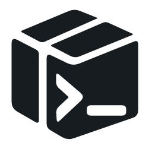
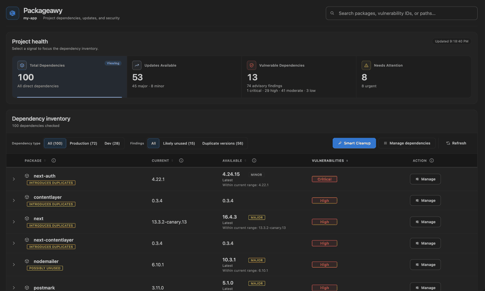
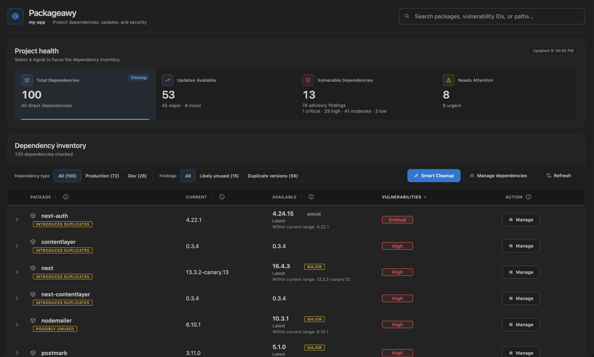
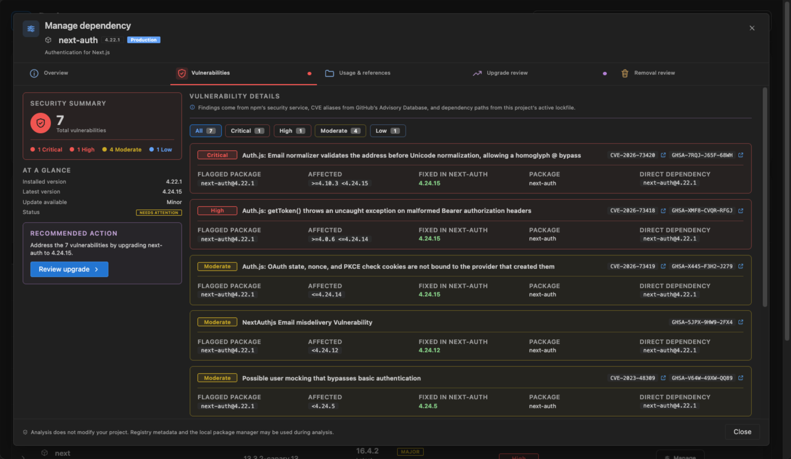
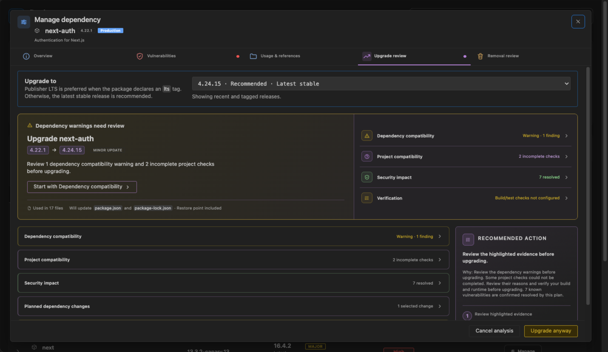
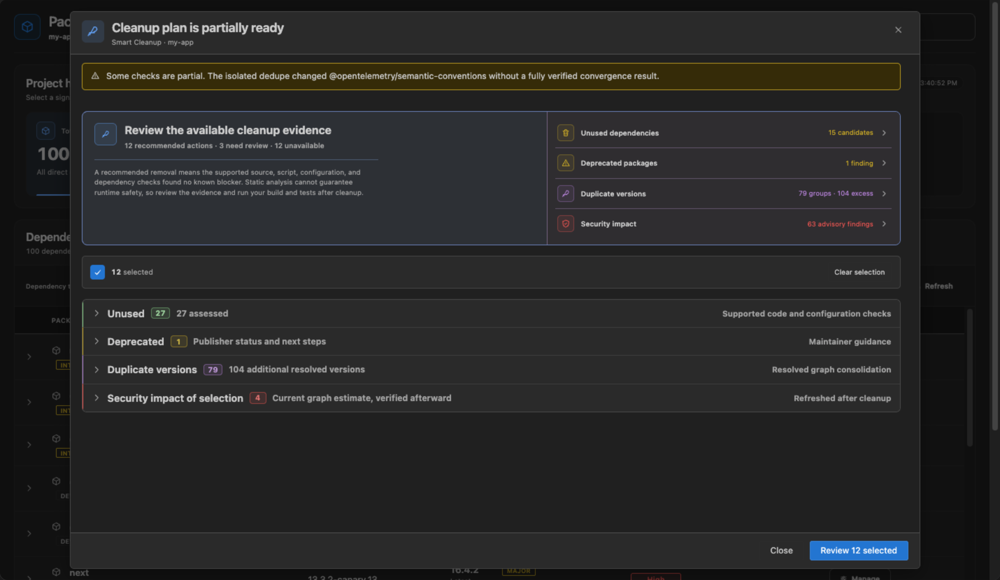

  

<h1 align="center">Packageawy (بكجاوي)</h1>

  Review, upgrade, and clean up npm and pnpm dependencies without leaving VS Code or your JetBrains IDE. 
  Packageawy checks every change before it happens and can roll it back if something goes wrong.

  <a href="https://marketplace.visualstudio.com/items?itemName=Azzam.packageawy">VS Code Marketplace</a> ·
  <a href="https://open-vsx.org/extension/Azzam/packageawy">Open VSX</a> ·
  <a href="https://plugins.jetbrains.com/plugin/35704-packageawy">JetBrains Marketplace</a> ·
  <a href="https://github.com/Azzam-Aldulaylan/packageawy/releases">Releases</a>

  
  
  
  
  
  

## Features

- **One table for every direct dependency.** See the installed version, what your range allows, the latest release, and the worst known vulnerability for each package.
- **Vulnerabilities with their full path.** Expand a row to see which transitive package is affected, how it got there, and which version fixes it. Aliased packages such as `npm:lodash@4.17.20` are checked under their real name.
- **Upgrade Review.** Before an upgrade, Packageawy checks peer dependencies, Node engine ranges, package exports, and your own imports. When peers conflict, it looks for a set of upgrades that works together. It also checks the proposed dependency tree for known vulnerabilities and shows any the upgrade would add. The version list marks Security fix, Publisher LTS, and Latest stable versions.
- **Upgrades that keep your style.** `^` and `~` ranges stay `^` and `~`, and `package.json` keeps its key order, indentation, and line endings.
- **Transitive fixes.** When a vulnerable package sits deep in the tree, Packageawy can often move just that package to a patched version without touching its parent.
- **Removal Review and Smart Cleanup.** Find packages that look unused and deprecated versions, with the evidence for each one. Nothing is removed until you confirm. A removal shows its progress and result in the dialog, and after a kept Smart Cleanup, **Restore dependency files** puts `package.json` and the lockfile back.
- **Safe by default.** Install scripts are off by default, changes run as a visible task, and dependency files are restored after a failed install. If verification fails, you choose whether to keep the change or roll back. When no verification scripts are set, reviews suggest the project's `typecheck`, `build`, `test`, and `lint` scripts.
- **Monorepos.** Pick any `package.json` in the workspace, or right-click one and choose **Open in Packageawy**. npm workspaces and pnpm importers are supported, and each npm workspace member shows its own installed versions.
- **Private registries.** Scoped registries from `.npmrc` are used for lookups. When a registry asks for sign-in, Packageawy says which one and keeps upgrades available for every other package.
- **Yarn and Bun projects.** Their dependencies are shown in the same table. Changes are available for npm and pnpm projects.

## Getting started

### VS Code

1. Install the Packageawy pre-release from the VS Code Marketplace or Open VSX. [Report bugs](https://github.com/Azzam-Aldulaylan/packageawy/issues).
2. Open a folder that contains a `package.json`.
3. Click the Packageawy icon in the Activity Bar, or run **Packageawy: Open** from the Command Palette (`Cmd+Shift+P` on macOS, `Ctrl+Shift+P` on Windows and Linux).
4. If the workspace has more than one `package.json`, pick the project you want to see. You can switch later with **Change Project**.

You can also right-click any `package.json` and choose **Open in Packageawy** to open that project directly.

Run **Packageawy: Refresh** to rescan at any time.

### JetBrains IDEs

1. In IntelliJ IDEA, WebStorm, PyCharm, PhpStorm, GoLand, Rider, or RubyMine (2026.1 or newer), open **Settings**, **Plugins**, **Marketplace**, search for **Packageawy**, and install it.
2. Open a project that contains a `package.json`.
3. Open the **Packageawy** tool window, or right-click a `package.json` and choose **Open in Packageawy**.

Settings are under **Settings**, **Tools**, **Packageawy**, with per-project options under **Project**.

## Reading the table

| Column | Meaning |
|---|---|
| Current | The installed version, from the lockfile. Without a lockfile, the declared range is shown with a tag such as `workspace`, `git`, or `unresolved`. |
| Wanted | The newest version your range in `package.json` allows. |
| Latest | The registry's `latest` version. For a prerelease install, a newer prerelease on the same version line can be shown. |
| Vulnerabilities | The worst severity found anywhere under this dependency: Critical, High, Moderate, Low, or Info. `Safe` means no known advisory. |

These follow the same meaning as `npm outdated`.

## How an upgrade works

1. Packageawy runs a compatibility check for the target version. When it can, it also resolves the change in a temporary copy of your project with scripts disabled.
2. If a peer dependency conflicts, it searches for a coordinated set of upgrades and shows it to you.
3. You review the planned changes, the findings, and the security impact.
4. After you confirm, it re-reads your project to make sure nothing changed, then saves a copy of `package.json` and the lockfile.
5. The install runs as a visible VS Code task or in the JetBrains Run tool window.
6. If you listed verification scripts (for example `test` or `build`), they run next. If you haven't, the review lists the project's `typecheck`, `build`, `test`, and `lint` scripts so you can check the ones to run, and "Remember for this project" saves your choice. Without any, the upgrade is reported as unverified.
7. If the install fails, or you choose to roll back after a failed verification, the saved files are restored. Rollback never overwrites edits you made in the meantime.

Only one change runs at a time.

## Cleaning up

- **Removal Review** checks your source files, package scripts, config files, other packages that need this one, and the security effect of removing it.
- **Manage dependencies** lets you filter and review several packages at once. A "likely unused" result is a reason to look, not permission to remove.
- **Smart Cleanup** combines unused-package evidence, deprecated versions, and security impact into one plan. Every recommended action is checked again right before it runs.

## Settings

These are the VS Code settings. JetBrains IDEs have the same options under **Settings**, **Tools**, **Packageawy**.

| Setting | Default | Description |
|---|---|---|
| `packageawy.registry.useProjectNpmrc` | `true` | Read the registry from the project's `.npmrc`. Values containing `${` are always rejected. Turn this off to use only your user-level `.npmrc`. |
| `packageawy.upgrade.ignoreScripts` | `true` | Pass `--ignore-scripts` when upgrading, so package lifecycle scripts don't run. |
| `packageawy.upgrade.verificationScripts` | `[]` | Script names from `package.json` to run after an install, for example `["test", "build"]`. |
| `packageawy.security.publicAdvisoryCheck` | `true` | Check dependencies for known vulnerabilities through npm's public advisory service, GitHub's advisory API, and npm audit. Can be set per project or folder. When it is off, the Vulnerabilities column reads Off. |
| `packageawy.cacheTtlMinutes` | `30` | How long cached results count as fresh, in minutes. `0` always rechecks on open. |
| `packageawy.debug.performance` | `false` | Log local timing measurements to the developer consoles. Nothing is sent anywhere. |

## Caching and refresh

- A fresh, complete cache supplies dashboard data without a network scan. Stale cached results are shown while a scan runs in the background.
- While the panel is open, a timer checks every 30 minutes whether a refresh is due.
- Changes to `package.json`, `package-lock.json`, `npm-shrinkwrap.json`, or `pnpm-lock.yaml` are picked up automatically.
- In VS Code, caches live in the extension's storage. Project results are stored per workspace. Registry and advisory caches are shared between workspaces.

## Workspace Trust

In VS Code, Packageawy reads the project's `.npmrc` and can run your package manager, so it only activates in trusted workspaces. It checks trust again before reading `.npmrc` and before every install.

## Privacy and network access

**Packageawy collects no telemetry, analytics, or tracking data.** It does contact npm, GitHub, and your configured registries to check dependencies. Those services see normal request details such as your IP address, plus:

- **Package metadata.** Package names, and exact versions for version lookups, go to your registry (public npm by default). The registry comes from your user `.npmrc` and, when enabled, the project's `.npmrc`, including scoped registries.
- **Vulnerability checks.** `https://registry.npmjs.org/-/npm/v1/security/advisories/bulk` receives package names and resolved versions from dependency scans, from upgrade reviews (the installed and the proposed dependency tree), and from proposed transitive-fix graphs, including private package names. Offered update versions are included in the same public advisory requests. These requests always go to public npm, even when you use a private registry. Source files and dependency paths are not sent.
- **CVE and GHSA identifiers.** GitHub's public advisory API (`https://api.github.com/advisories`) receives batches of affected package names to look up identifiers. No source, versions, or paths are sent. If GitHub is unavailable, the npm finding is still shown.
- **Fix information.** A local `npm audit --json --package-lock-only` run sends lockfile information to npm's advisory service.
- **Review checks.** Isolated npm or pnpm resolution runs with scripts disabled, and `npm pack --ignore-scripts` may download a target version to inspect its files. These request package metadata and archives from your registry. Your source code is never uploaded.
- **Changes you confirm.** Installs and removals use your package manager and its configuration. If you enable lifecycle scripts or verification scripts, that code can make its own network requests.

The dashboard itself never fetches remote data. Clicking a CVE opens its NVD page and clicking a GHSA opens its GitHub page in your browser.

Package names and versions are still information about your project, so check your organization's policy before scanning private projects. You can turn off the vulnerability checks, identifier lookups, and fix information for any project with the `packageawy.security.publicAdvisoryCheck` setting.

## Requirements

- VS Code 1.90 or newer, on desktop, or a JetBrains IDE 2026.1 or newer with a JCEF-enabled runtime.
- In JetBrains IDEs, Node.js. Packageawy requires a stable Node.js release: 18.17.x through 18.x, or 20.5.0 or newer. It uses the Node.js interpreter configured in the IDE, or `node` on PATH.
- An npm or pnpm project. For pnpm, a lockfile from pnpm 9 or newer.
- Registry sign-in stays with your package manager. Packageawy never reads or stores auth tokens.

## Contributing

Bug reports and pull requests are welcome. See [CONTRIBUTING.md](CONTRIBUTING.md) to get set up, and [SECURITY.md](SECURITY.md) to report a vulnerability privately.

## License

[MIT](LICENSE)
