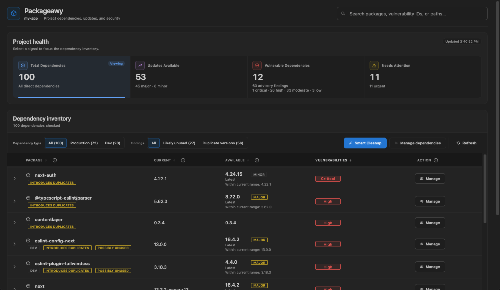
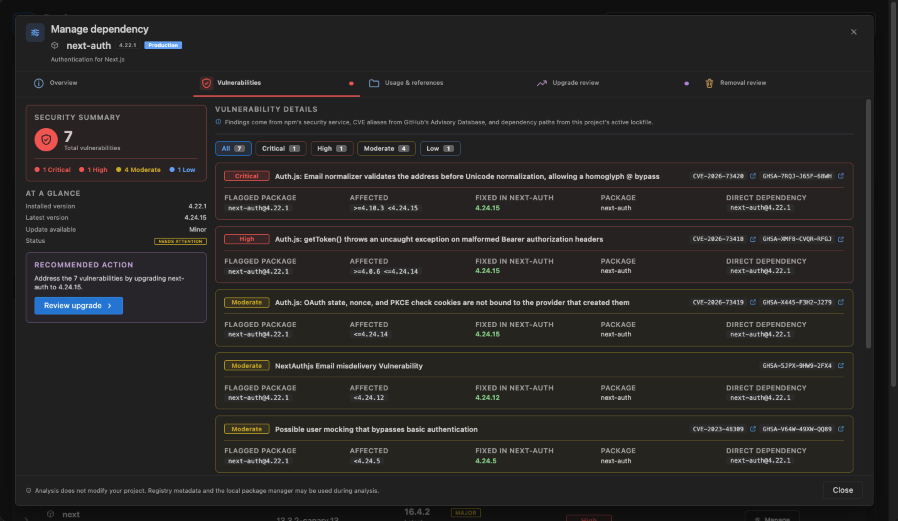
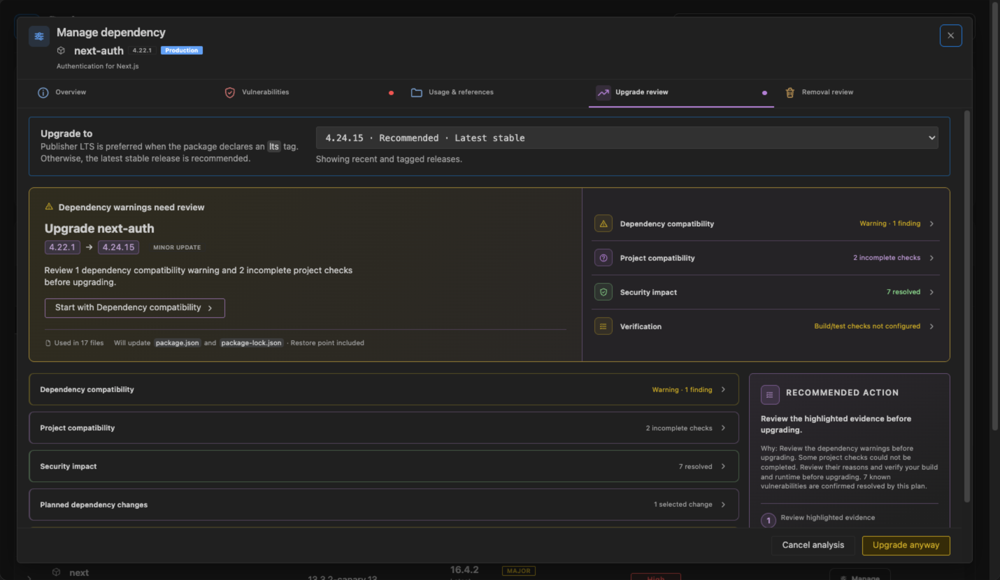
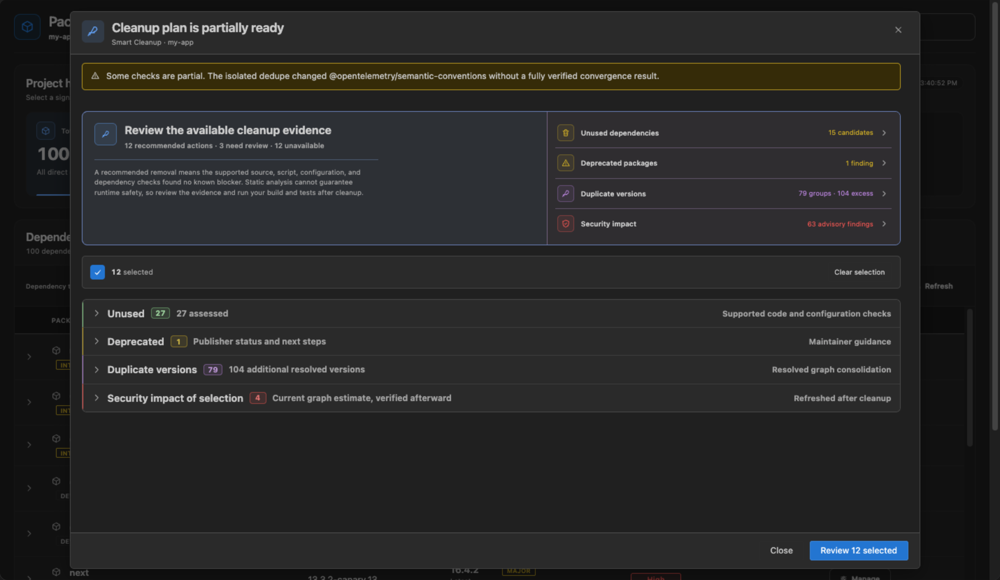

# Packageawy (بكجاوي)

Review, upgrade, and clean up npm and pnpm dependencies without leaving VS Code. Packageawy checks every change before it happens and can roll it back if something goes wrong.

## Features

- **One table for every direct dependency.** See the installed version, what your range allows, the latest release, and the worst known vulnerability for each package.
- **Vulnerabilities with their full path.** Expand a row to see which transitive package is affected, how it got there, and which version fixes it.
- **Upgrade Review.** Before an upgrade, Packageawy checks peer dependencies, Node engine ranges, package exports, and your own imports. When peers conflict, it looks for a set of upgrades that works together.
- **Transitive fixes.** When a vulnerable package sits deep in the tree, Packageawy can often move just that package to a patched version without touching its parent.
- **Removal Review and Smart Cleanup.** Find packages that look unused, deprecated versions, and duplicate installs, with the evidence for each one. Nothing is removed until you confirm.
- **Safe by default.** Install scripts are off, changes run as a visible VS Code task, and `package.json` and the lockfile are restored if the install or your verification scripts fail.
- **Monorepos.** Pick any `package.json` in the workspace. npm workspaces and pnpm importers are supported.

## Getting started

1. Install Packageawy from the VS Code Marketplace. It is a pre-release for now, so please [report anything that feels off](https://github.com/Azzam-Aldulaylan/packageawy/issues).
2. Open a folder that contains a `package.json`.
3. Click the Packageawy icon in the Activity Bar, or run **Packageawy: Open** from the Command Palette (`Cmd+Shift+P` on macOS, `Ctrl+Shift+P` on Windows and Linux).
4. If the workspace has more than one `package.json`, pick the project you want to see. You can switch later with **Change Project**.

Run **Packageawy: Refresh** to rescan at any time.

## Reading the table

| Column | Meaning |
|---|---|
| Current | The installed version, from the lockfile. Without a lockfile, the declared range is shown with a tag such as `workspace`, `git`, or `unresolved`. |
| Wanted | The newest version your range in `package.json` allows. |
| Latest | The newest stable version on the registry. |
| Vulnerabilities | The worst severity found anywhere under this dependency: Critical, High, Moderate, Low, or Info. `Safe` means no known advisory. |

These follow the same meaning as `npm outdated`.

## How an upgrade works

1. Packageawy runs a compatibility check for the target version. When it can, it also resolves the change in a temporary copy of your project with scripts disabled.
2. If a peer dependency conflicts, it searches for a coordinated set of upgrades and shows it to you.
3. You review the planned changes, the findings, and the security impact.
4. After you confirm, it re-reads your project to make sure nothing changed, then saves a copy of `package.json` and the lockfile.
5. The install runs as a visible VS Code task.
6. If you listed verification scripts (for example `test` or `build`), they run next. Without them, the upgrade is reported as unverified.
7. If the install fails, or you choose to roll back after a failed verification, the saved files are restored. Rollback never overwrites edits you made in the meantime.

Only one change runs at a time.

## Cleaning up

- **Removal Review** checks your source files, package scripts, config files, other packages that need this one, and the security effect of removing it.
- **Manage dependencies** lets you filter and review several packages at once. A "likely unused" result is a reason to look, not permission to remove.
- **Smart Cleanup** combines unused-package evidence, deprecated versions, duplicate installs, and security impact into one plan. Every recommended action is checked again right before it runs.

## Settings

| Setting | Default | Description |
|---|---|---|
| `packageawy.registry.useProjectNpmrc` | `true` | Read the registry from the project's `.npmrc`. Values containing `${` are always rejected. Turn this off to use only your user-level `.npmrc`. |
| `packageawy.upgrade.ignoreScripts` | `true` | Pass `--ignore-scripts` when installing, so package lifecycle scripts don't run. |
| `packageawy.upgrade.verificationScripts` | `[]` | Script names from `package.json` to run after an install, for example `["test", "build"]`. |
| `packageawy.cacheTtlMinutes` | `30` | How long cached results count as fresh, in minutes. `0` always rechecks on open. |
| `packageawy.debug.performance` | `false` | Log local timing measurements to the developer consoles. Nothing is sent anywhere. |

## Caching and refresh

- With a fresh cache the dashboard opens instantly with no network calls. With a stale cache it shows the cached results and rechecks in the background.
- While the panel is open, a timer checks every 30 minutes whether a refresh is due.
- Changes to `package.json`, `package-lock.json`, `npm-shrinkwrap.json`, or `pnpm-lock.yaml` are picked up automatically.
- Caches live in VS Code's extension storage. Project results are stored per workspace. Registry and advisory caches are shared between workspaces.

## Workspace Trust

Packageawy reads the project's `.npmrc` and can run your package manager, so it only activates in trusted workspaces. It checks trust again before reading `.npmrc` and before every install.

## Privacy and network access

**Packageawy collects no telemetry, analytics, or tracking data.** It does contact npm, GitHub, and your configured registries to check dependencies. Those services see normal request details such as your IP address, plus:

- **Package metadata.** Package names, and exact versions for version lookups, go to your registry (public npm by default). The registry comes from your user `.npmrc` and, when enabled, the project's `.npmrc`, including scoped registries.
- **Vulnerability checks.** `https://registry.npmjs.org/-/npm/v1/security/advisories/bulk` receives the names and installed versions of every package in the dependency tree. This always goes to public npm, even when you use a private registry. Private package names are not filtered out yet. Source files and dependency paths are not sent.
- **CVE and GHSA identifiers.** GitHub's public advisory API (`https://api.github.com/advisories`) receives batches of affected package names to look up identifiers. No source, versions, or paths are sent. If GitHub is unavailable, the npm finding is still shown.
- **Fix information.** A local `npm audit --json --package-lock-only` run sends lockfile information to npm's advisory service.
- **Review checks.** Isolated npm or pnpm resolution runs with scripts disabled, and `npm pack --ignore-scripts` may download a target version to inspect its files. These request package metadata and archives from your registry. Your source code is never uploaded.
- **Changes you confirm.** Installs and removals use your package manager and its configuration. If you enable lifecycle scripts or verification scripts, that code can make its own network requests.

The dashboard itself never fetches remote data. Clicking a CVE opens its NVD page and clicking a GHSA opens its GitHub page in your browser.

Package names and versions are still information about your project, so check your organization's policy before scanning private projects.

## Limitations

- Yarn and Bun are not supported.
- pnpm support targets lockfile format v9. pnpm catalogs, aliases, and pnpm-specific audit data are not supported yet.
- Workspace-linked packages are recognized, but their own manifests are not checked during compatibility analysis.
- Private registry authentication is left to your package manager. Packageawy never reads or stores auth tokens.
- The table lists direct dependencies. Transitive vulnerabilities appear under the direct dependency that brings them in.
- Container images, OS packages, and globally installed tools are not scanned.
- Desktop VS Code only. The extension runs local npm and Node processes, so it does not work in vscode.dev.

See the [roadmap](docs/roadmap.md) for planned work.

## Contributing

Bug reports and pull requests are welcome. See [CONTRIBUTING.md](CONTRIBUTING.md) to get set up, and [SECURITY.md](SECURITY.md) to report a vulnerability privately.

## License

[MIT](LICENSE)
